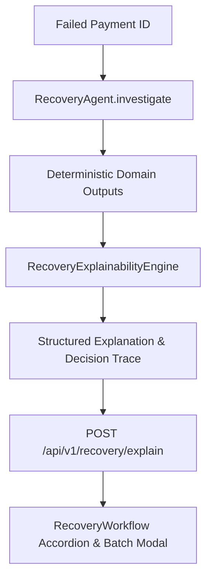

# Phase 9 Walkthrough — Explainable Recovery Intelligence & Decision Transparency

## 1. Overview
**Phase 9** introduces **Explainable Recovery Intelligence & Decision Transparency** to the ReviveAI platform. This additive, 100% deterministic, and read-only subsystem answers:
1. **Why is a payment eligible or blocked?** (Evaluates failure codes, retry limits, subscription statuses, transaction amounts).
2. **Why does the ML system predict a particular recovery probability?** (Maps calibrated outputs to deterministic confidence bands: HIGH, MEDIUM, LOW).
3. **Why was a particular action recommended?** (Clarifies decision engine rules: `RETRY_PAYMENT`, `RETRY_WITH_CAUTION`, `SEND_PAYMENT_REMINDER`, `ESCALATE_TO_HUMAN`, `DO_NOT_RETRY`, `DEFER_RECOVERY`).
4. **What is the financial impact?** (Quantifies Gross Revenue at Risk & Probabilistic Expected Recovery Value).
5. **What deterministic steps led to the final decision?** (Generates a structured 5-step Decision Trace).

Crucially, this adheres strictly to the core safety rule: **Explainability is Read-Only. The explainability engine does not alter decisions, modify retry counts, trigger payment execution, move money, or call money-moving APIs.**

---

## 2. New Files Created

| File | Purpose |
|---|---|
| [`backend/app/domain/recovery/explainability.py`](file:///c:/Users/kanee/Desktop/ReviveAI/backend/app/domain/recovery/explainability.py) | Pure deterministic explainability engine (`RecoveryExplainabilityEngine`, `DecisionTraceStep`, `interpret_probability_confidence`). Consumes existing outputs from the investigation pipeline without re-evaluating or modifying state. |
| [`backend/tests/test_explainability.py`](file:///c:/Users/kanee/Desktop/ReviveAI/backend/tests/test_explainability.py) | 21 comprehensive unit & integration tests covering eligibility explanations, probability bands, financial consistency, decision traces, API behavior, and read-only invariants. |
| [`frontend/src/components/RecoveryExplanation.jsx`](file:///c:/Users/kanee/Desktop/ReviveAI/frontend/src/components/RecoveryExplanation.jsx) | UI component showing Recovery Intelligence KPIs (Confidence, Prob., Action, Priority, EV) and "Why Did ReviveAI Make This Decision?" factor cards. |
| [`frontend/src/components/DecisionTimeline.jsx`](file:///c:/Users/kanee/Desktop/ReviveAI/frontend/src/components/DecisionTimeline.jsx) | Visual chronological 5-step Decision Trace pipeline (`Payment Analysis` → `Eligibility Check` → `Recovery Prediction` → `Revenue Risk` → `Decision`). |

---

## 3. Modified Files

| File | Modifications |
|---|---|
| [`backend/app/api/routes/recovery.py`](file:///c:/Users/kanee/Desktop/ReviveAI/backend/app/api/routes/recovery.py) | Added `POST /api/v1/recovery/explain` endpoint. Consumes `RecoveryAgent.investigate()` and produces structured explanations and decision traces. (No LLM invoked, 100% deterministic). |
| [`frontend/src/api/recovery.js`](file:///c:/Users/kanee/Desktop/ReviveAI/frontend/src/api/recovery.js) | Added `getRecoveryExplanation(paymentId)` API client function calling `POST /api/v1/recovery/explain`. |
| [`frontend/src/components/RecoveryWorkflow.jsx`](file:///c:/Users/kanee/Desktop/ReviveAI/frontend/src/components/RecoveryWorkflow.jsx) | Integrated an expandable accordion: **"WHY DID REVIVEAI MAKE THIS DECISION?"** which asynchronously loads and renders `RecoveryExplanation` and `DecisionTimeline`. |
| [`frontend/src/components/BatchDashboard.jsx`](file:///c:/Users/kanee/Desktop/ReviveAI/frontend/src/components/BatchDashboard.jsx) | Added an **Explain** action button to every row of the batch breakdown table. Clicking opens a modal rendering the full explanation and trace for that specific payment on demand. |

---

## 4. Explainability Architecture & Response Structure



### Response Schema (`POST /api/v1/recovery/explain`):
```json
{
  "payment_id": "pay_002610",
  "explainability": {
    "eligibility_explanation": {
      "eligible": true,
      "summary": "Payment is eligible for bounded recovery under deterministic policy.",
      "factors": [
        {
          "factor": "Transient Failure (Temporary Bank Failure)",
          "impact": "positive",
          "explanation": "This failure reason indicates a transient network or banking issue that is potentially recoverable."
        },
        {
          "factor": "Retry Count (1/2)",
          "impact": "positive",
          "explanation": "Retry count (1) is within the deterministic policy threshold (max 2 retries)."
        },
        {
          "factor": "Amount Check (₹28,100.45)",
          "impact": "positive",
          "explanation": "Transaction amount is within the automatic safety ceiling (₹50,000)."
        }
      ]
    },
    "prediction_explanation": {
      "recovery_probability": 0.8876,
      "confidence_level": "HIGH",
      "summary": "The ML model predicts a 88.8% likelihood of recovery (HIGH confidence), indicating strong historical recovery indicators."
    },
    "decision_explanation": {
      "recommended_action": "RETRY_PAYMENT",
      "priority": "HIGH",
      "summary": "Deterministic decision engine recommends immediate bounded retry (Priority: HIGH). High expected recovery value with favorable transient failure characteristics."
    },
    "financial_impact": {
      "revenue_at_risk": 28100.45,
      "expected_recovery_value": 24941.96,
      "currency": "INR"
    }
  },
  "decision_trace": [
    {
      "step": "Payment Analysis",
      "status": "COMPLETE",
      "value": "pay_002610 (FAILED)",
      "explanation": "Payment record loaded with amount INR 28,100.45."
    },
    {
      "step": "Eligibility Check",
      "status": "PASS",
      "value": "Eligible",
      "explanation": "Payment meets deterministic policy criteria."
    },
    {
      "step": "Recovery Prediction",
      "status": "COMPLETE",
      "value": "88.8% (HIGH)",
      "explanation": "The calibrated ML model predicted 88.8% recovery probability."
    },
    {
      "step": "Revenue Risk",
      "status": "COMPLETE",
      "value": "₹28,100.45 (EV: ₹24,941.96)",
      "explanation": "Quantified revenue at risk of ₹28,100.45 with ₹24,941.96 expected recovery."
    },
    {
      "step": "Decision",
      "status": "RECOMMENDED",
      "value": "RETRY_PAYMENT (HIGH)",
      "explanation": "Deterministic decision engine evaluated priority as HIGH and recommended RETRY_PAYMENT."
    }
  ]
}
```

---

## 5. Verification & Test Results

### Automated Unit & Integration Tests
Ran `pytest tests -v` across the entire backend suite:
```
============================= 84 passed in 11.73s =============================
```
- **84 / 84 tests PASSED** (including 21 new tests in `test_explainability.py`).

### Critical Invariants Verified
1. `test_explain_does_not_create_audit_records`: Calling `/explain` triggers 0 audit entries.
2. `test_explain_is_idempotent_and_deterministic`: Output is identical across identical inputs.
3. `test_explain_does_not_modify_investigation_object`: Domain inputs remain untouched.

### Benchmark Scenario Validation
Ran `python scripts/validate_scenarios.py`:
```
====================================================================
  [OK] VALIDATION COMPLETE -- 78 checks passed, 0 failed
====================================================================
```
- **78 / 78 benchmark scenario checks PASSED**.

### Frontend Production Build
Ran `npm run build` in `frontend/`:
```
✓ built in 2.14s
dist/index.html                   0.45 kB │ gzip:  0.29 kB
dist/assets/index-D516dW6X.css   49.47 kB │ gzip:  8.09 kB
dist/assets/index-DP_e96AA.js   267.36 kB │ gzip: 76.40 kB
```
- **Vite production bundle generated cleanly with 0 errors.**

---

## 6. Demo Instructions for Judges & Merchants

1. **Single Payment Workflow Analysis:**
   - Search `pay_002610` (High Value Transient Failure).
   - In the **Recovery Workflow** section, click **"WHY DID REVIVEAI MAKE THIS DECISION?"**.
   - Observe the **Confidence: HIGH (88.8%)**, **Action: RETRY PAYMENT**, positive factor breakdown, and the 5-step Decision Trace showing `PASS` on eligibility and `RECOMMENDED` on Decision.
2. **Blocked Ineligible Payment:**
   - Search `pay_000016` (Permanent Payment Method Failure).
   - Click **"WHY DID REVIVEAI MAKE THIS DECISION?"**.
   - Observe **🚫 Recovery Blocked**, negative factor explaining why permanent failures are blocked, ML Prediction marked as `SKIPPED`, and Decision marked as `BLOCKED (DO NOT RETRY)`.
3. **Outreach & Customer Action:**
   - Search `pay_000012` (Insufficient Funds).
   - Click **"WHY DID REVIVEAI MAKE THIS DECISION?"**.
   - Observe how the explanation details why customer outreach (`SEND_PAYMENT_REMINDER`) is prioritized over an automated retry.
4. **Batch Mode On-Demand Explainability:**
   - Scroll to **Batch Revenue Recovery Intelligence** and click **"Run Demo Batch (9 payments)"**.
   - In the results table, click the **"🔍 Explain"** button on any payment row.
   - Inspect the on-demand modal with the exact breakdown and decision timeline for that payment.
